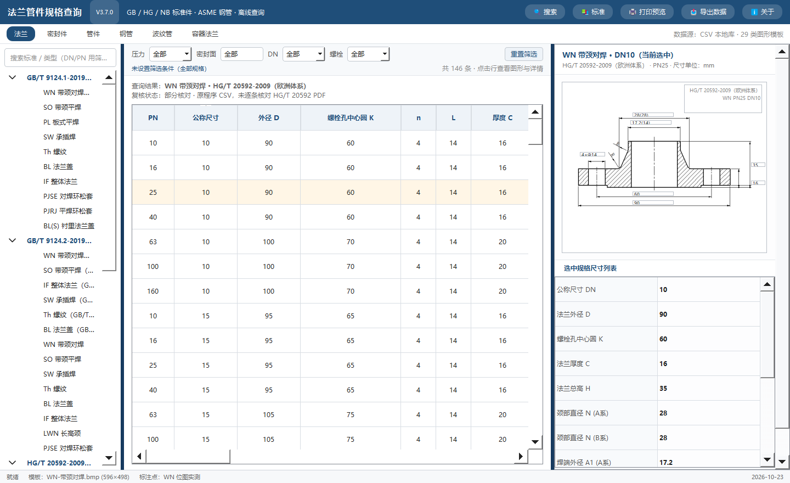
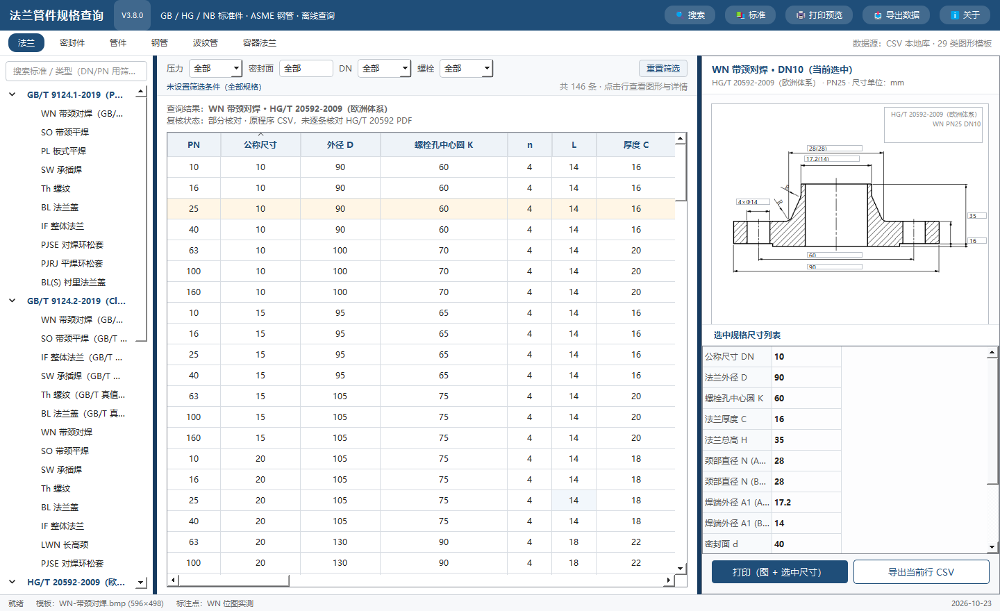

# 4.0「换骨」进度

## 已完成

### 1. 核心层

```text
FlangeQueryV2/core/
  review.py       来源、复核状态、覆盖矩阵
  page_spec.py    PageSpec 页面声明
  data.py         CSV 读取、列名归一
  page_kind.py    页面类型与行派生字段
  storage.py      SQLite 运行时（失败回退 CSV）
```

- 均不依赖 Qt（`storage` 仅用 sqlite3/json）；
- `main.py` 通过 import/re-export 保持原 API，现有 UI/测试不改调用方式；
- `PAGES` 页面项已是 `PageSpec`，仍可按 4 元组解包。

### 2. SQLite 运行时

- `main.on_tree` 优先从 `Data/data.db` 读取，失败回退 CSV；
- `FLANGE_SQLITE=0` 可强制 CSV；
- 页遍历、导出测试在 SQLite 路径下通过。

### 3. Model/View 主表替换

- `ui/data_table.py`：`DataTable(QTableView)` + `CellTableModel(QAbstractTableModel)`；
- 主数据表已全量从 `QTableWidget` 切换为 `QTableView`；
- 保留现有调用协议：`setItem/item/selectRow/selectedItems/sortItems/列宽记忆`；
- 自定义表头排序，避免 `setSortingEnabled(True)` 覆盖默认 DN 升序；
- 4900 行页面加载实测约 **0.6s**；
- KV 列表已抽为 `ui/kv_panel.py`（QTableView + QStandardItemModel）；
- 搜索/覆盖对话框已抽到 `ui/dialogs.py`，同样使用 Model/View；
- 顶栏与分类工具条已抽到 `ui/chrome.py`；
- 主窗口 `main.py` 只负责布局组装和业务回调。

界面抽检：



### 4. SQLite 打包回归

- 3.8.0 打包后的 `_internal/Data/data.db`：58 张表、`manifest.json` 完整；
- 抽查 `GBT9124_2_带颈对焊.csv` 对应表：12 列、112 行，与 CSV 一致；
- 源码侧 58 份 CSV 与 SQLite 全量逐行比对通过；
- 打包启动标题：`法兰管件规格查询 V3.8.0`。

### 5. 测试

新增：

- `tests/test_page_spec.py`
- `tests/test_core_layers.py`
- `tests/test_storage.py`
- `tests/test_table_model.py`
- `tests/test_data_table.py`
- `tests/test_sqlite_parity.py`

测试总数：**92**。

## 矢量绘图评估

已完成 WN 同规格（PN16/DN50）矢量 vs BMP 对比：

- 矢量图比例失常、结构缺失、尺寸线重叠；
- BMP 结构完整、符合法兰剖面形状。

结论：**当前矢量图不优于 BMP，保持默认关闭**。
详见 `docs/矢量绘图评估_2026-10-23.md`。


### 6. 3.8.1 安装包与安装实测

- Inno Setup 3.8.1 安装包已生成：28.8 MB，解包验证含 58 份 CSV、`data.db`、29 份模板；
- 安装包 SHA256：`1197748977cf43b85a321909904ee4a99184b84e7c4ddf98a41d6ce771cf7cf6`；
- 受宿主 HKCU 策略限制，Inno 安装器仍无法在本会话完成注册表写入；
- 免临时目录方案对 3.8.1 完成真实安装 → 启动（V3.8.1）→ 卸载，目录与快捷方式全部清理；
- 尝试计划任务、Explorer 快捷方式启动 Inno 安装器均被宿主策略阻断，**普通桌面 Inno 安装/卸载仍未实测**；
- 代码签名：`signtool.exe` 与代码签名证书均未找到，3.8.1 安装包未签名。

## MainWindow 拆分

- 顶栏/分类工具条 → `ui/chrome.py`；
- 左侧标准树 → `ui/tree_panel.py`；
- 中间筛选条 + 数据表 → `ui/center_panel.py`；
- 右侧图形/尺寸栏 → `ui/side_panel.py`；
- 状态栏 → `ui/statusbar.py`；
- 图形卡 → `ui/drawing_card.py`；
- 筛选逻辑 → `ui/filters.py`；
- 搜索解析/跨页搜索 → `core/search.py`；
- 导出 → `ui/export_controller.py`；
- 打印 → `ui/print_controller.py`；
- 页面生命周期（切树/填表/选中行）→ `ui/page_controller.py`；
- `_build_main` 现在只负责 `QSplitter` 组装。

界面抽检：



## 下一批

1. 在普通桌面完成 Inno 安装/卸载实测（需可写 HKCU/开始菜单环境）；
2. 继续收敛 `main.py` 的页面加载/表格填充/树事件；
3. 4.0 正式发布前补安装包签名与回归；
4. 矢量绘图另立课题，先重写几何，再评估是否替换 BMP。

## 注意

- 3.8.0 已构建 exe/zip/安装包，作为 4.0 阶段预览；
- 主表、KV、搜索/覆盖对话框均已迁到 Model/View；
- SQLite 运行时与 CSV 全量一致。
