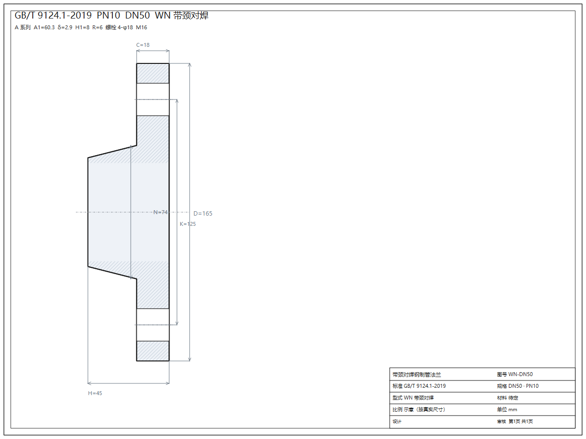

# GB/T 9124.1-2019 PN10 DN50 法兰图

按应用查询结果绘制：**GB/T 9124.1-2019，PN10，DN50，A 系列，WN 带颈对焊**。



## 数据来源

`Data/GBT9124_1_带颈对焊.csv` 中：

| 字段 | 值 |
|---|---|
| PN | 10 |
| DN | 50 |
| A1_A | 60.3 |
| D | 165 |
| K | 125 |
| L | 18 |
| n | 4 |
| Th | M16 |
| C | 18 |
| N_A | 74 |
| S_min | 2.9 |
| H1_mean | 8 |
| R | 6 |
| H | 45 |

## 图形说明

- 外形：接管端 → 锥颈 → 法兰盘；
- 内孔：按 `A1 - 2×S_min` 计算；
- 法兰外径 `D`、螺栓孔中心圆 `K`、螺栓孔 `φL`、数量 `n`、螺纹 `Th`；
- 法兰厚度 `C`、总高 `H`、颈部外径 `N`；
- 螺栓孔按上下对称剖切表示；
- 带 45° 剖面线和 A3 图框/标题栏。

## 尚未表达

- 密封面型式：数据表没有 RF/FF 密封面直径，图中暂按平面端面；
- 材料：标题栏“待定”；
- 法兰重量、坡口细节未标注。

## 复现

```bash
python - <<'PY'
import main
from flange_drawing import render_gb_flange
row = next(r for r in main.load_csv('Data/GBT9124_1_带颈对焊.csv')
           if r['PN'] == '10' and r['DN'] == '50')
render_gb_flange(row, 1200, 900).save('docs/assets/flange_gb9124_1_pn10_dn50.png')
PY
```

其他 DN 使用同一函数，传入对应行即可。
