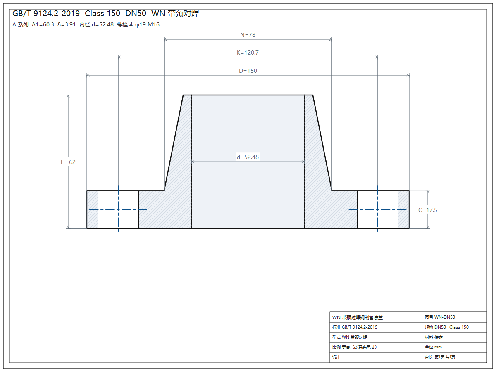
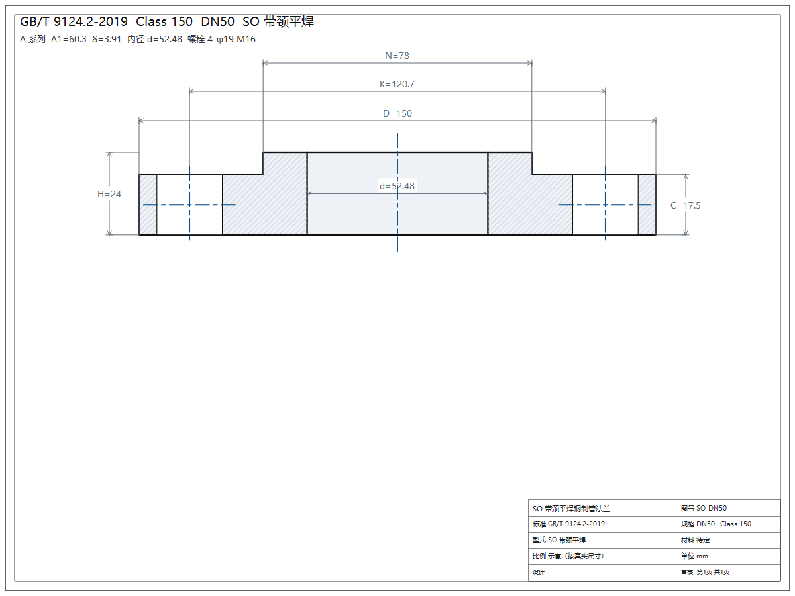
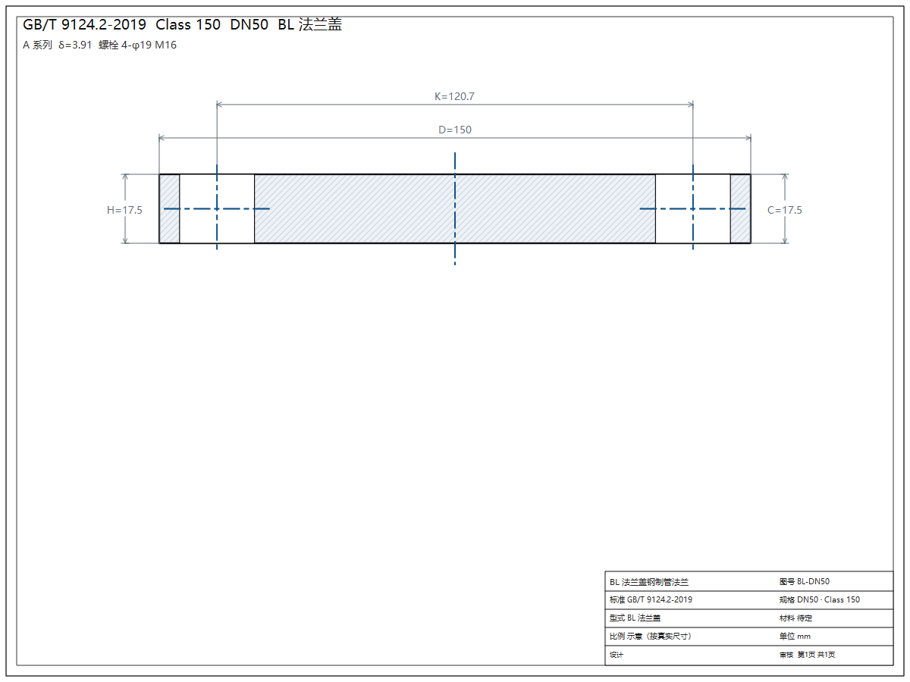

# GB/T 9124 法兰矢量图

## 0. 2026-10-24 横向改版

- 轴向改为竖直，法兰盘横向展开；
- 内孔用加粗黑色实线单独绘制；
- `D/K/N` 在顶部横排，`H/C` 在两侧竖排；
- 内径 `d` 在孔内横排；
- 尺寸文字 13px，白底压线，分道布置；\n- 侧栏另用 800×500 紧凑画布，文字 26px、箭头 12px，图形居中；\n- 内孔/螺栓孔均有蓝色点划中心线。

## 一、已支持的型式

| 型式 | 模板 | 数据来源 | 状态 |
|---|---|---|---|
| WN 带颈对焊 | `WN-带颈对焊.bmp` | GB/T 9124.1 PN、GB/T 9124.2 Class | ✅ 矢量 |
| SO 带颈平焊 | `SO-带颈平焊.bmp` | GB/T 9124.2 Class | ✅ 矢量 |
| IF 整体法兰 | `IF整体法兰.bmp` | GB/T 9124.2 Class | ✅ 矢量 |
| SW 承插焊 | `SW承插焊.bmp` | GB/T 9124.2 Class | ✅ 矢量 |
| Th 螺纹 | `Th螺纹.bmp` | GB/T 9124.2 Class | ✅ 矢量 |
| BL 法兰盖 | `BL法兰盖.bmp` | GB/T 9124.2 Class | ✅ 矢量 |
| PL 板式平焊 | `PL板式平焊.bmp` | HG/T 20592 | ✅ 平板轮廓 |
| PJSE/PJRJ | `PJSE...`/`PJRJ...` | HG/T 20592 | ⚠️ 通用松套轮廓，非完整标准 |

## 二、绘图规范

- 外轮廓、内孔线全部黑色；
- 金属壁 45° 剖面线；
- 尺寸分道：`D` 最右、`K` 次右、`N` 左侧、`C/H` 上下；
- 尺寸文字压在尺寸线中点，白底断开尺寸线；
- 图框 + 标题栏；
- 侧栏只显示 `DN/型式`，其余尺寸由 KV 列表显示。

## 三、样张

WN：



SO：



BL：



## 四、数据限制

1. **GB/T 9124.2 已增加 `S`/`d_bore` 字段**
   - `S`：钢管壁厚；`d_bore`：内径；
   - 默认按 ASME B36.10M **Sch40** 填充：`d_bore = A1 - 2S`；
   - 标准表本身不规定壁厚，默认值不是唯一答案；
   - 可用 `tools/add_gb9124_2_bore.py --schedule STD/Sch80` 重算。

2. **GB/T 9124.1 非 WN 页仍是 HG 别名**
   - 页面虽在 GB 组下，数据仍复用 HG/T；
   - 矢量为通用型式，不等于 GB/T 9124.1 真值。

3. **IF 整体法兰没有 H**
   - 图中 H 为按 `C+(N-A1)/2` 推导，标为 `H≈`。

4. **PJSE/PJRJ**
   - 需要翻边短节/松套环尺寸，暂不绘制，继续用 BMP。

## 五、测试

```text
Ran 100 tests
OK
```

覆盖：GB/T 9124.1 PN10 全部 DN、GB/T 9124.2 WN/SO/IF/SW/Th/BL、及 PL/PJ 通用轮廓。
