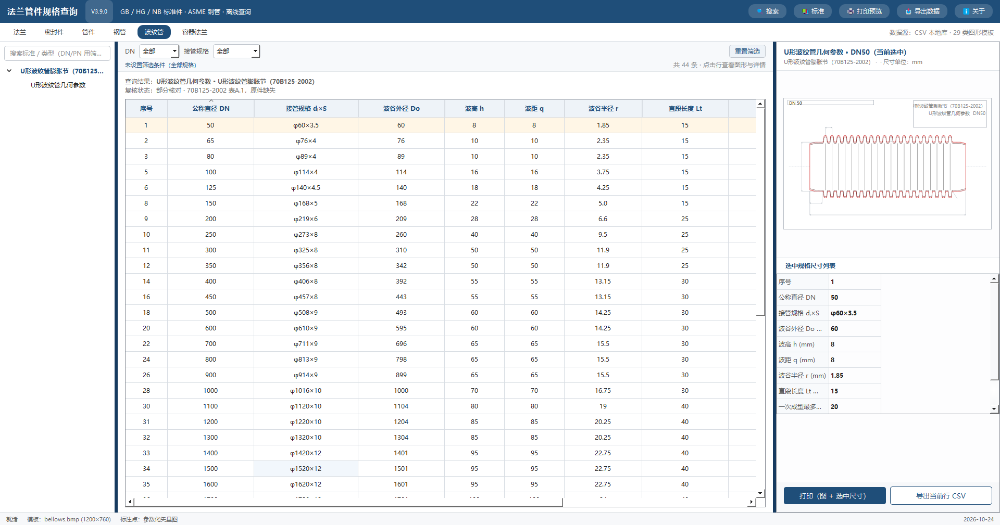
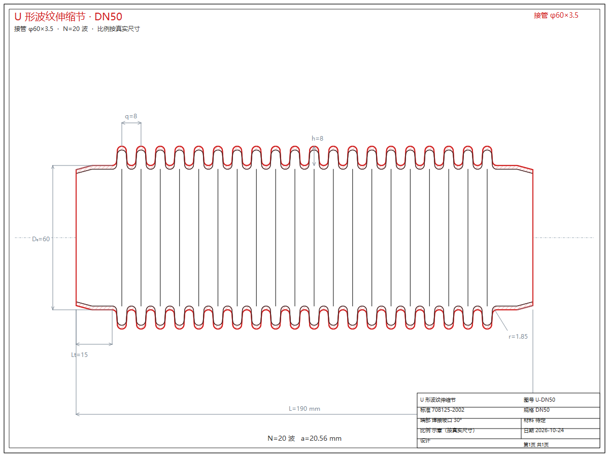
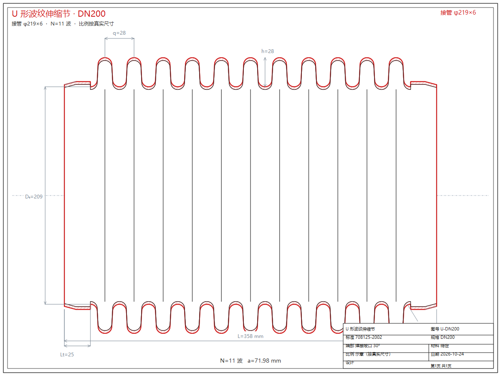
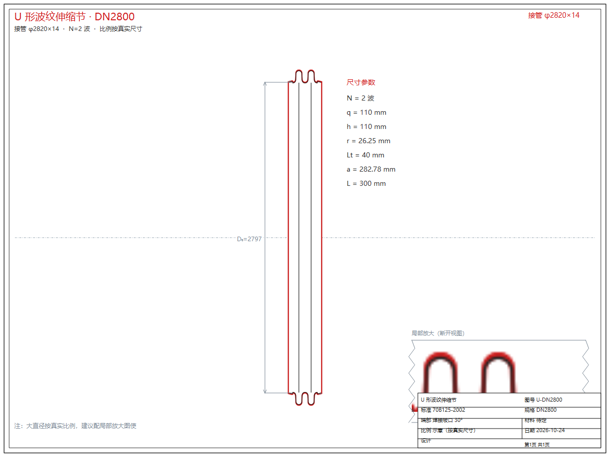

# 波纹伸缩节矢量验证

日期：2026-10-23  
数据：`Data/U_bellows.csv`（44 行，DN50–DN2800）  
实现：`bellows_drawing.py`（QPainter 参数化剖面）

## 应用内默认效果（3.9.0）

3.9.0 起，波纹管页面默认使用矢量图；`FLANGE_BELLOWS_VECTOR=0` 可强制回退 BMP。



## 一、验证目标

用真实几何参数绘制 U 形波纹伸缩节剖面，替代 `templates/bellows.bmp` 的“6 个圆圈”示意：

- 接管外径、壁厚（从 `接管规格` 解析）；
- 波谷外径 `D_o`、波高 `h`、波距 `q`、波数 `N`、直段 `Lt`、展开长度 `a`；
- 左右管端、波纹段、内外壁、中心线；
- 尺寸标注：`D_o`、`h`、`q`、`r`、`Lt`、`N`、`a`。

## 二、样张

DN50（N=20 波，D_o=60，h=8，q=8）：



DN200（N=11 波，D_o=209，h=28，q=28）：



DN2800（N=2 波，真实比例下极窄）：



## 三、结论

### 可以画

- DN50、DN200 等常用规格能画出**可辨认的真实剖面**：管端、N 个波、波高/波距/直段均按数据比例；
- 红色外轮廓、黑色内壁/波谷内衬线、金属壁剖面线已对齐参考图；
- 矢量线条在任意缩放下清晰，尺寸标注可随图输出；
- 比原 BMP 的 6 个圆圈示意明显更接近实物。

### 已完成的关键项

1. **圆弧 + 直边严格相切**
   - 波谷/波峰按 `r` 做圆弧；
   - 直边通过解析公切线求切点，圆弧与直边连续相切。

2. **大直径带断裂线局部放大**
   - DN2800 真实比例下是细条，右下角增加 3 波局部放大；
   - 放大窗左右用断裂线表示断开，不再只是矩形边框。

3. **标签已拆层**
   - `render_bellows(..., show_labels=False)` 输出纯几何；
   - 侧栏只叠加 `DN`，其余尺寸由 KV 列表显示；
   - PDF 可用 `show_labels=True` 输出完整标注。

4. **焊接端 + 图框/标题栏**
   - 端部改为 30° 焊接坡口，不再用短法兰示意；
   - 增加 A3 图框和右下角标题栏；
   - 标题栏含：图号、标准、规格、端部、材料、比例、日期、设计/审核、页码。

### 仍需确认

- **材料**：当前标题栏为“待定”，需按实际材料填写；
- **法兰**：如果产品要求带法兰，需补对应标准法兰尺寸，不能沿用焊接端；
- **比例**：当前为“示意（按真实尺寸）”，正式出图需标实际比例；
- **审核/设计**：标题栏签字栏为空。

## 四、判断

**矢量图已具备“示意图 + 图框”的完整外观，可作为预审图使用；还不是正式交付工程图。**

建议：

- 若要正式交付：补材料、法兰标准、比例和签字；
- 在此之前，默认仍用 BMP，矢量保持实验开关。

## 五、复现

```bash
python tools/render_bellows_samples.py
```

生成：

- `docs/assets/bellows_vector_dn50.png`
- `docs/assets/bellows_vector_dn200.png`
- `docs/assets/bellows_vector_dn1000.png`
- `docs/assets/bellows_vector_dn2800.png`
