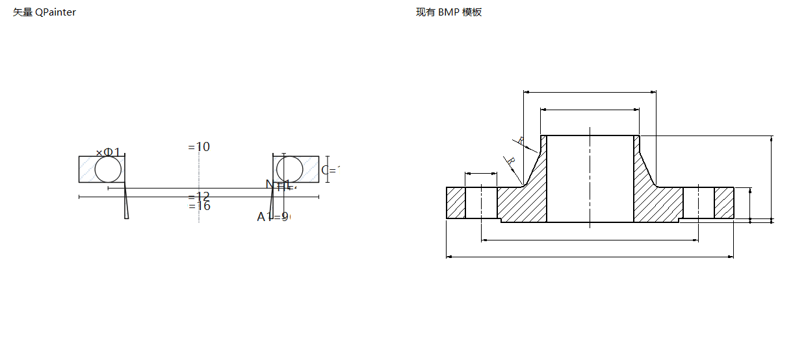

# 矢量绘图评估（2026-10-23）

> 对象：`drawing.render_flange`（QPainter 参数化 WN 剖面）
> 对照：`templates/WN-带颈对焊.bmp`（现有正式图）
> 样例：HG/T 20592 WN，PN16，DN50

## 对比图

## 观察

矢量图当前存在明显问题：

1. **比例失常**：法兰图形缩在中间，宽高比与模板不一致；
2. **结构缺失**：没有完整的法兰盘、螺栓孔、剖面线，颈部/盘部轮廓不闭合；
3. **尺寸线错位**：`N`、`C`、`A1` 等标注线与文字重叠；
4. **文字被裁切**：尺寸值只显示局部，无法阅读；
5. **与标准图形不符**：BMP 模板是完整全剖立面，符合法兰工程图习惯；矢量图更像草图。

现有 BMP：

- 法兰盘、颈部、螺栓孔、剖面线完整；
- 尺寸线布局符合模板；
- 数值由程序按实测坐标叠加，当前显示正常。

## 结论

**当前矢量图不比现有 BMP 更合适、更美观，也不更符合法兰形状。**

因此：

- `VECTOR_ENABLED` 保持默认 `False`；
- 矢量代码保留为实验特性（`FLANGE_VECTOR=1`），不进入正式界面；
- 如果继续推进矢量，应重写几何与标注布局（盘/颈/孔/剖面线、尺寸线分层），而不是在现有 `render_flange` 上微调。

## 对 4.0 的影响

矢量绘图暂不纳入 4.0 交付范围；4.0 先完成：

1. Model/View 全量替换；
2. SQLite 运行时默认化；
3. 数据/页面层继续解耦。

矢量绘图作为独立课题，等几何重写完成后再评估。
