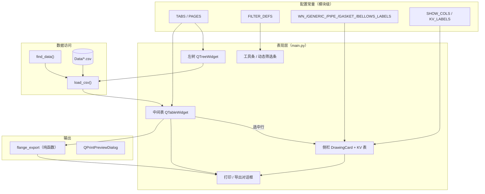
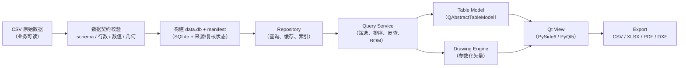

# FlangeQuery V3.0.0 项目分析与升级建议

> 分析对象：`FlangeQueryV2/`（V3.0.0，2026-10-21 发布）
> 关联资产：`FlangeSheet_V1.00/`（原程序与 28 份 CSV）、`_reverse/`（逆向与几何原型）、`标准规范/`（标准归档）
> 分析方式：源码与数据静态审阅、现有运行截图交叉验证。本次未重新执行测试与打包（当前会话环境无法启动外部进程）。
> 结论时点：2026-10-22
> 清理状态（2026-10-22）：`_reverse/` 已移至 `_archive/reverse/`；5 份未引用模板已移至 `_archive/unused_templates/`；`dist_onedir/`、`build/` 已删除。

---

## 0. 结论摘要

**一句话结论：V3.0.0 已经是一款“能用的离线查表工具”，功能覆盖 69 个子页；当前最大风险不在功能多少，而在数据正确性没有闭环（丢行、标准错配、伪 PN、推断值不可见），其次是单文件架构与位图标注限制了继续扩展。**

建议节奏：

1. **先止血（3.0.1，3–5 天）**：修复“每个 CSV 丢第一行”等 P0 缺陷，补行数契约测试；
2. **再立信（3.1，约 3 周）**：列名归一、数据来源角标、GB/HG 标注、每类法兰独立标注、CI 与数据契约测试；
3. **后换骨（4.0，约 8–10 周）**：分层 + 声明式页面描述 + Model/View + 参数化矢量绘图 + SQLite 数据包 + 安装包/签名。

### 0.1 健康度评估（主观）

| 维度 | 评分 | 主要依据 |
|---|---|---|
| 功能完整度 | 8.5 / 10 | 6 页签、18 组、69 子页，打印预览与 CSV 导出齐备 |
| 数据正确性 | 4.5 / 10 | 26 个 CSV 丢首行；Class 体系伪 PN；GB/T 页签复用 HG/T 数据；部分垫片值为推断/网络转写 |
| 架构可维护性 | 4.0 / 10 | `main.py` 1558 行，页面配置散落 5 处，新增标准要改多处 |
| 测试有效性 | 4.0 / 10 | 8 个用例，只验证“能加载/能导出”，不验证数据对不对 |
| 交付与运维 | 5.5 / 10 | 有版本单一来源、日志、构建校验、SHA256；缺 git、CI、签名、安装器 |
| 使用体验 | 6.5 / 10 | 信息架构清晰；图形卡被裁切、大表筛选不可用、切页签不清理 |
| **综合** | **5.5 / 10** | 可用，但需先补正确性与工程化，再谈功能扩张 |

### 0.2 最值得马上处理的三件事

| 序号 | 问题 | 影响 | 处理 |
|---|---|---|---|
| 1 | 首列为空表头时，`load_csv` 多跳一行，26 个 CSV 各丢第一条记录 | HG/T 20592 WN 丢失 PN10/DN10；查询、导出、打印全部受影响，且无任何提示 | 3.0.1 必修，附行数契约测试 |
| 2 | GB/T 9124.1 / 9124.2 两个页签直接读取 HG/T 20592 / 20615 的 CSV | 用户按 GB/T 标准号选型、导出、出图，实际数据来源是 HG/T，存在合规与责任风险 | 界面/导出显式标注来源；中期补 GB 真值 |
| 3 | 除 WN 外，其余法兰类型共用 WN 的标注坐标 | 数值标签落在模板的错误位置，专业性受损 | 短期逐类建坐标表；中期上参数化矢量绘图 |

---

## 1. 项目概览

### 1.1 定位与场景

面向管道/化工设计、采购与现场人员的**离线单机标准件查询工具**：按标准与型式选表，按 PN/Class、DN、密封面、螺栓等条件筛选，查看规格表、示意图形与尺寸详情，并支持打印预览与 CSV 导出。程序不联网，数据与模板随包分发，适合内网、现场与无网络环境。

### 1.2 规模

| 项目 | 数值 |
|---|---|
| 主程序 | `main.py` 1558 行；`flange_export.py` 34 行；`version.py` 8 行 |
| 页面 | 6 个分类页签 / 18 个标准分组 / 69 个子页 |
| 数据 | 51 份 CSV（法兰、垫片、钢管、管件、波纹管） |
| 图形 | 34 份 BMP，其中 29 份被引用，5 份为冗余资源 |
| 测试 | 2 个测试文件、8 个用例（其中 1 个用例遍历 69 页） |
| 打包 | 单文件 EXE + 文件夹版 + 便携 zip + SHA256 清单 |
| 依赖 | PyQt5 5.15.11、PyInstaller 6.22.3 |

### 1.3 目录结构

```text
FlangeGetData/
├─ FlangeQueryV2/                 # 当前产品（V3.0.0）
│  ├─ main.py                     # 主窗口、树、筛选、表格、图形卡、打印、导出
│  ├─ flange_export.py            # 导出纯函数（可单测）
│  ├─ version.py                  # 版本唯一来源
│  ├─ Data/                       # 51 份 CSV
│  ├─ templates/                  # 34 份 BMP 模板
│  ├─ tests/                      # 单元 + GUI 集成测试
│  ├─ tools/build_release.py      # 构建、校验、SHA256
│  ├─ FlangeQueryV2.spec          # 单文件打包
│  ├─ FlangeQueryV2_onedir.spec   # 文件夹版打包
│  ├─ dist/ dist_onedir/ _打包/   # 构建产物（应清理）
│  └─ 启动法兰查询.bat             # 源码启动脚本
├─ FlangeSheet_V1.00/             # 被逆向的原程序与原始 CSV
├─ _reverse/                      # 逆向脚本、截图、几何原型（约 3100 个文件）
└─ 标准规范/                       # 标准归档与覆盖总表
```

### 1.4 已经做得好的地方

- **离线可用、形态完整**：单文件版适合临时分发，文件夹版启动快；不依赖网络与数据库服务。
- **覆盖广**：法兰 6 个标准组、垫片 8 个标准 + 密封面参考、钢管 7 页、管件 5 页、波纹管 1 页，69 个子页在同类工具中已属完整。
- **数据以 CSV 为单一事实源**：便于业务人员直接核对、diff、替换，不需要数据库工具。
- **工程化已有雏形**：版本号单一来源、文件日志与全局异常钩子、窗口/页签记忆、打印预览、导出纯函数、构建时资源数量校验与 SHA256。
- **回归意识**：`tests/test_page_exports.py` 能遍历 69 页验证“可加载、可选行、列不丢”，这在单人维护的项目里很难得。
- **注释质量高**：对历史 bug 根因（如 `pic/label` 生命周期、QSS 背景污染）有明确记录，降低了后续接手成本。

---

## 2. 架构分析

### 2.1 现状结构



**特征**：典型的“配置常量 + 单个 QMainWindow”结构。所有页面元数据（标准分组、CSV、模板、标签坐标、筛选项、详情字段）都是模块级常量，UI 在初始化时读取这些常量构建控件；没有独立的领域模型、仓储层或服务层。

### 2.2 关键数据流

1. `build_tree()` 遍历 `PAGES`，为每个 CSV 存在且有模板的子页建立树节点，`Qt.UserRole` 保存 `(名称, CSV, 模板, 标签配置, 标准组)`。
2. 点击树节点 → `on_tree()`：`page_kind()` 判定页面类型 → `find_data()` 定位 CSV → `load_csv()` 读入 `list[dict[str, str]]` → `build_filters()` 按 `FILTER_DEFS` 重建筛选条 → `fill_table()` 建表。
3. 筛选 → `_filtered_rows()` 在内存中逐行 `_match()`，结果重新填充 `QTableWidget`。
4. 选中行 → `on_row()`：`DrawingCard.show_page()` 加载 BMP、按 `SCALE` 缩放、按像素坐标叠加 `QLabel`；右侧键值表按 `KV_LABELS` 或页面类型动态生成。
5. 打印 → `_render_print_page()` 把 `card` 与 `kv` 两个控件 `render()` 到 QPrinter，按纸张大小整体缩放。
6. 导出 → `_export()` 用 `resolve_export_columns()` 决定列，`write_csv()` 写 UTF-8-SIG。

### 2.3 配置驱动方式

| 关注点 | 配置位置 | 现状 |
|---|---|---|
| 页面清单 | `PAGES`（main.py:234-341） | 元组字面量，含显示名、CSV、模板、标签字典 |
| 分类页签 | `TABS`（main.py:344-351） | 前缀匹配分组标题 |
| 筛选项 | `FILTER_DEFS`（main.py:401-467） | 按 `page_kind()` 返回的类型选取 |
| 图形标注 | `WN_LABELS`、`GENERIC_LABELS` 等（main.py:93-232） | 模板像素坐标 + 格式化字符串 |
| 表格列 | `SHOW_COLS`（main.py:354-364） | 法兰通用列 |
| 详情键值 | `KV_LABELS`（main.py:366-373） | 法兰通用字段 |
| 导出列 | `SHOW_COLS` + 当前表格列（flange_export.py） | 运行时组合 |

**问题**：新增一个标准/型式，至少要在 `PAGES`、`FILTER_DEFS`、`*_LABELS`、`KV_LABELS`/`SHOW_COLS`、`fill_table()`/`on_row()` 的分支逻辑中改 5 处；漏改不会报错，只会静默显示 `-` 或错位。这是当前维护成本的主要来源。

### 2.4 架构评价

**优点**

- 依赖少、部署简单，符合“内网单机工具”的定位。
- CSV + 模板的外部化设计，让非程序员可以参与数据维护。
- 纯函数 `flange_export.py` 与 `version.py` 是良好的分层起点。
- 测试能在无显示环境下跑，具备进入 CI 的基础。

**局限**

- **UI 与业务耦合**：筛选、排序、格式化、页面类型判断都在 `MainWindow` 里，无法脱离 Qt 测试。
- **全字符串数据模型**：所有值都是 `str`，用 `''`/`'-'` 表示空值；排序、比较、导出各自解析，容易出现规则不一致。
- **固定像素布局**：`SCALE=0.7`、侧栏 430px、模板坐标硬编码，导致裁切、DPI 与分辨率适配问题。
- **位图 + 绝对坐标的图形方案**：只能“看起来像”，无法随尺寸参数变化，也无法输出真正的矢量图纸。
- **无版本控制**：项目根目录只有 `.gitignore`，没有 `.git`；数据变更、谁改了什么、为什么改都不可追溯。

---

## 3. 问题清单

> 严重度定义：P0 = 数据错误/结果不可信；P1 = 可信度、合规或可维护性风险；P2 = 体验与工程卫生。

### 3.1 P0：正确性缺陷

#### P0-1 每个“带索引列”的 CSV 都会丢失第一条数据（26 个文件）

**证据**

- `main.py:644-649`：

```python
head = [h.strip() for h in rows[0]]
if head and head[0] == '':
    head = head[1:]
    rows = [r[1:] for r in rows[1:]]   # 此时 rows 已不含表头
data = []
for r in rows[1:]:                     # 又跳过了第一条数据
```

- `Data/HGT20592_带颈对焊.csv` 共 147 行：1 行表头 + 146 行数据（索引 0–145），第一行是 `0,10,10,17.2,...`（PN10/DN10）。
- 现有界面截图 `FlangeQueryV2/_ui_check.png` 显示该页“共 145 条”，且 DN10 的首行从 PN16 开始——**PN10/DN10 已丢失**。

**影响**：26 个 CSV（HG/T 20592 全部 10 个、HG/T 20615 全部 8 个、HG/T 20623 全部 4 个、ANSI B36、GB12459_GBT13401、HGJ514、HGJ528）各丢一条记录。对最常见的 WN 法兰，丢的正是最小规格 PN10/DN10，属于“用户一查就少一行”的硬伤；导出、打印、统计全部继承该错误，且没有任何日志或提示。

**修复**：把表头处理与数据行分离，见 5.2 节补丁；同时增加“加载行数 == CSV 行数 − 1”的契约测试。

#### P0-2 列数不符的行被静默丢弃

**证据**：`main.py:650-651` 直接 `continue`，不记录行号、不提示。

**影响**：数据文件一旦被手工编辑出多余/缺失的逗号，查询结果会悄悄少行，用户无法察觉；与 P0-1 叠加后，问题更难定位。

**修复**：收集跳过的行号并 `logger.warning`，状态栏显示“已跳过 N 行”；数据契约测试要求跳过数为 0。

### 3.2 P1：可信度、合规与可维护性

#### P1-1 GB/T 9124 页签复用了 HG/T 数据，界面未披露

**证据**：`main.py:235-256` 中，`GB/T 9124.1-2019` 组的 10 个子页全部指向 `HGT20592_*.csv`，`GB/T 9124.2-2019` 组指向 `HGT20615_*.csv`；README 已承认“复用 HG/T 20592/20615 的衔接尺寸，不等同于逐条扫描国标原文”。

**影响**：用户选择“GB/T 9124.1-2019”，页头也显示 GB/T，但数据实际来自 HG/T。用于报价、采购、出图或合规审查时，标准号与数据来源不一致，存在责任风险。且两套页签内容完全重复，用户容易误以为是两套独立数据。

**修复**：短期在页头、图形卡角标、导出文件名/首列标注“数据源：HG/T 20592-2009（GB/T 9124.1 待逐条复核）”；中期补录 GB/T 9124.1/2 真值，或合并为“欧洲体系/美洲体系”并按数据来源切换，而不是按标准号复制页面。

#### P1-2 Class 体系 CSV 的 PN 列写成了 `class_150` 等伪值

**证据**：

- `Data/HGT20615_带颈对焊.csv` 第 2 行：`0,150,class_150,15,"1/2""",...`
- `HGT20615_法兰盖.csv` 表头为 `,PN2,PN,...`，PN 列同样为 `class_150`，且没有 `Class` 列。
- `HGT20623_带颈对焊A系列.csv` 同样是 `Class=150, PN=class_150`。

**影响**：

- 表格与导出同时出现 `Class 150` 和 `class_150` 两列，语义重复且写法不合规；
- `HGT20615_法兰盖` 页因为缺少 `Class` 列，`FILTER_DEFS['hgt20615']` 中的“压力等级 Class”筛选器不会生成，详情标题也显示为 `class_150 DN...`；
- 任何下游按 PN 汇总/比对的脚本都会把 Class 体系混进 PN 体系。

**修复**：Class 体系文件的 PN 列应置空；若确需 PN 对照，增加独立字段 `PN_equiv` 并注明换算依据；对 `HGT20615_法兰盖` 补齐 `Class` 列，统一表头。

#### P1-3 除 WN 外，其余法兰共用 WN 的标注坐标

**证据**：`main.py:93-102` 定义 `WN_LABELS`，`GENERIC_LABELS = dict(WN_LABELS)`，随后 SO/PL/SW/Th/BL/IF/PJSE/PJRJ/BL(S)/LWN/容器法兰全部使用 `GENERIC_LABELS`。注释也写明“WN 页坐标经位图实测修正，其余页后续逐页精修”。

**影响**：不同模板（法兰盖、板式平焊、松套、容器法兰）的轮廓位置差异很大，数值标签会落在空白处或压住轮廓。图形卡是用户判断“这个规格长什么样”的主要依据，错位会直接削弱专业可信度。

**修复**：短期为每类模板建立独立 `LABELS`，并加“渲染截图 + 人工抽检”的回归清单；中期用参数化矢量绘图替代位图 + 绝对坐标（`_reverse/gen_dwg.py` 已有可参考原型）。

#### P1-4 侧栏图形卡被裁切

**证据**：

- 侧栏固定 430px（`main.py:1021`），水平滚动条被关闭（`main.py:1023`）；
- stage 左右各 12px 边距（`main.py:1047`），再加上竖向滚动条约 17px，可用宽度约 `430-17-24=389px`；
- 图形卡固定宽度 `int(596*0.7)+3=420px`（`main.py:43`、`791`）。

420 > 389，右侧约 31px 被裁掉；现有截图 `_ui_check.png` 中法兰右缘与右侧标注确实贴边缺失。

**修复**：按可用宽度自适应缩放（`scale = min(0.7, (viewport_width-26)/596)`），并在 `resizeEvent` 中重算；或取消固定宽度，改用 `QSplitter` + `QScrollArea` 自适应。

#### P1-5 列名不统一，详情页出现 `-`

**证据**：

| 文件 | 异常列 | 说明 |
|---|---|---|
| `HGT20615_螺纹.csv` | `kg` | `KV_LABELS` 使用 `m_kg`，详情质量显示 `-` |
| `HGT20615_承插焊.csv` | `RF_d.1` | pandas 去重后缀，属于数据准备残留 |
| `HGT20615_法兰盖.csv` | `PN2`、无 `Class` | 与同组其他文件表头不一致 |
| `HGT20615_长高颈.csv`、`HGT20592_法兰盖.csv` | `RJ_R` | 其他文件用 `RJ_r`，大小写不一致 |
| `HGT20615_带颈对焊.csv` | `LZM` | 其他文件为 `LZJ` |
| `HGT20592_对焊环松套.csv`、`平焊环松套.csv` | `PJ_m_kg`、`SE_m_kg`、`RJ_m_kg` | 质量字段被拆成多个变体 |
| `HGT20592_整体.csv` | 无 `A1_A/A1_B` | 通用 `KV_LABELS` 仍显示 A1 行，值为 `-` |

**影响**：详情、导出、下游比对都会受字段名影响；用户看到大量 `-` 会怀疑数据缺失。字段命名本应有统一字典（如 `D`、`K`、`C`、`m_kg`），目前是各文件各自演化。

**修复**：建立“尺寸代号字典 + 别名映射”，在 `load_csv` 后统一归一化；对无法映射的列在构建期报错。所有文件表头纳入契约测试。

#### P1-6 推断值与“网络补全值”对用户不可见

**证据**：`gen_gasket_data.py:10-25` 明确记录：部分垫片厚度 `T` 按经验推断（如 FF/RF 的 `DN<=600` 取 1.5），HG/T 20607/20610/20611/20612/20627/20631 的数值来自公开标准表转写而非原始 PDF；README 仅笼统提示“需复核”。

**影响**：用户无法在界面区分“标准值”和“推断/补全值”。一旦用于正式选型，错误会直接进入采购与施工。

**修复**：数据行或数据文件级增加 `来源/复核状态`（如 `verified`、`inferred`、`web`）；界面用角标/底色提示“待复核”；导出附来源列；未复核数据默认不进入打印数据单。

#### P1-7 标准覆盖缺口没有产品化呈现

**证据**：`标准规范/标准规范归档总表.md` 统计：项目引用 20 项标准，已归档 9 项，待归档 11 项；HG/T 20627 仅收录 Class 150/300/600；GB/T 13402、JB/T 74~86、NB/T 47020~47027 尚未覆盖；70B125-2002 原件缺失。

**影响**：用户不知道“哪些标准是全的、哪些只是节选”。例如查 HG/T 20627 Class 900 会查不到，但界面没有任何“本表未收录”的提示。

**修复**：增加“标准覆盖矩阵”页面（标准号、版本、数据来源、覆盖 PN/Class 范围、复核状态、缺口说明）；在与标准号相关的页头显示覆盖状态。

#### P1-8 没有版本控制、CI 与数据契约测试

**证据**：项目根目录存在 `.gitignore`，但不存在 `.git/HEAD`；无 `.github/`、`gitlab-ci.yml`、`pyproject.toml`；测试只有 `tests/test_export_utils.py` 与 `tests/test_page_exports.py`，不校验行数、表头、数值范围；`_audit_full.py` 是临时脚本，未纳入 `tests/`。

**影响**：数据与代码变更不可追溯；P0-1 这类错误没有任何自动化拦截；`_audit_full.py` 里把 596×498 当作模板唯一合格尺寸（对 pipe/fittings 只会产生 WARN），说明临时脚本的校验口径也会漂移。

**修复**：`git init` + 分支/提交规范；CI 执行 `ruff` + `pytest` + 打包 smoke；把审计脚本改造成数据契约测试；为每个 CSV 生成 `manifest`（校验和、行数、来源）。

#### P1-9 发行链路与许可风险

**证据**：

- PyQt5 采用 GPLv3/商业双许可。内部使用通常没问题，但一旦随产品分发给客户、合作方或子公司，就需要评估 GPL 义务或购买商业许可；PySide6 为 LGPL，更友好。
- 两个 spec 都启用 `upx=True`，单文件版又未签名，容易触发杀软误报与 SmartScreen“未知发布者”。
- `tools/build_release.py:20` 把 `FlangeQueryV2-3.0.0.sha256` 写死，版本升级后会生成旧文件名；`:97` 把资源数量写死为 `51/34`，新增标准即失败。
- `启动法兰查询.bat:16` 写死 `C:\Users\Administrator\.workbuddy\...` 的本机 Python 路径，换机即失效。
- `dist_onedir/` 是早期版本产物（Data 中无垫片 CSV，且仍有 `GB17395_钢管系列.csv` 旧文件），与 `dist/`、`_打包/` 并存，存在误发旧包的风险。

**修复**：从 `version.py` 派生所有产物名与资源清单；构建改为 onedir + Inno Setup 安装器 + 代码签名；单文件版关闭 UPX 或排除 Qt DLL；`.bat` 只做 `python main.py` 探测；清理旧构建目录；评估 PySide6。

### 3.3 P2：体验与工程卫生

| 编号 | 问题 | 证据 | 建议 |
|---|---|---|---|
| P2-1 | 1558 行单文件，UI/配置/业务耦合 | `main.py` 全文 | 拆分为 core/services/ui/drawing 四层；页面配置改为 `PageSpec` 数据类 |
| P2-2 | `QTableWidget` 全量建 item，大表卡顿 | `fill_table()` 为每行每列创建 `QTableWidgetItem`；GB/T 17395 普通钢管约 4925 行 | 改用 `QAbstractTableModel` + `QSortFilterProxyModel`，填充期间关闭排序 |
| P2-3 | 壁厚/尺寸筛选用单选下拉，取值过多不可用 | `gbt_pipe` 的“壁厚S(mm)”有数百个取值；钢管 `Sch` 列同理 | 数值区间筛选 + 关键字过滤 + “常用值”置顶 |
| P2-4 | 切换分类页签不清理表格 | `on_tab()` 只隐藏树节点，表格与 `cur_page` 保留旧页 | 切换时清空表格/详情，或恢复该页签上次页面 |
| P2-5 | 状态栏模板尺寸写死 596×498 | `main.py:1403`，但 pipe.bmp 为 200×176、fittings 为 520×460 | 从 QPixmap 实际尺寸读取 |
| P2-6 | 5 份模板未被引用 | `623法兰.bmp`、`容器法兰-凹凸面2/平面/榫槽面.bmp`、`pipe_thin.bmp` | 删除或接入对应页面；构建时校验孤儿资源 |
| P2-7 | 导出/打印能力单一 | 仅 CSV、仅当前行打印数据单 | 增加 XLSX、PDF 数据单（带图框/标题栏/审核栏）、多选/整表打印、复制到剪贴板 |
| P2-8 | 高 DPI/字体缩放适配不足 | 固定像素 `setFixedSize`/`setGeometry`；标签字号 8–12px | 使用布局 + `QFontMetrics` + 可缩放图形视图；提供界面缩放 |
| P2-9 | 工程目录混杂 | `_reverse/` 约 3100 个文件（含 pylibs/pytz/xdis），与产品源码同目录 | 移到 `research/` 或独立仓库；`.gitignore` 排除构建产物与逆向依赖 |
| P2-10 | 文档与实现漂移 | README 写 `dist\...`，实际还有 `dist_onedir`、`_打包`；测试报告版本与代码需同步 | 文档由构建脚本生成版本与资源数量；发布物只保留一个目录 |

---

## 4. 升级方案

### 4.1 总体思路

**不重写、不换语言、不先做 3D。** 以“数据可信 → 结构可扩展 → 体验增值”为顺序，保留现有 UI 风格与 CSV 资产，逐步替换最脆弱的两个环节：**页面配置方式**与**图形呈现方式**。

目标架构：



### 4.2 数据层升级

**目标**：让“数据对不对”变成可自动验证、可追溯、可在界面表达的状态。

1. **保留 CSV 作为编辑格式**，构建期生成 SQLite：
   - 优点：业务人员仍可用 Excel 核对；程序查询/排序/索引更快；数据包可整体替换。
   - 表设计：`flange(standard, type, pn, class, dn, ...)`、`pipe(...)`、`gasket(...)`、`fitting(...)`、`bellows(...)`，外加 `dim(code, name_cn, unit, standard_clause)` 字典表。
2. **列名归一**：建立代号字典（`D/K/C/H/N_A/A1_A/RF_d/m_kg/...`）与别名映射（`kg→m_kg`、`RJ_R→RJ_r`、`RF_d.1→RF_d_dup`），加载时统一；无法映射直接构建失败。
3. **数据契约**（CI 必跑）：
   - 每个文件表头 ⊆ 字典，必需列齐全；
   - 行数 = 原始 CSV 行数 − 1，且无跳过行；
   - 数值列可解析、非负；`m_kg > 0`；`D2 >= D1`（垫片）；`n` 为正偶数；`D >= K`；
   - 同一标准同一 `(type, PN/Class, DN)` 唯一；
   - 跨文件一致性：同一 DN 的 `A1_A` 在 20592 各型式间一致；同一垫片标准的 `D1/D2` 与法兰密封面匹配。
4. **来源与复核状态**：每个 CSV 配一份 `manifest.json`：

```json
{
  "file": "HGT20592_带颈对焊.csv",
  "standard": "HG/T 20592-2009",
  "source": {"type": "pdf", "doc": "HG/T 20592-2009", "pages": [12, 13]},
  "review": {"status": "verified", "by": "张工", "date": "2026-10-20"},
  "units": {"DN": "mm", "m_kg": "kg"},
  "sha256": "..."
}
```

   `status` 建议三档：`verified`（逐条核对）、`partial`（部分核对/节选）、`inferred`（推断或网络转写）。界面用角标显示，导出带来源列。
5. **覆盖矩阵**：把 `标准规范归档总表.md` 的 20 项标准做成应用内页面，显示版本、归档状态、覆盖 PN/Class/DN 范围、数据来源、复核人。用户查不到时能看到“本表未收录 Class 900”而不是空白。

### 4.3 界面层升级

1. **声明式页面描述**，消灭 5 处同步修改：

```python
@dataclass(frozen=True)
class PageSpec:
    code: str                 # HGT20592-WN
    group: str                # HG/T 20592-2009
    tab: str                  # 法兰
    kind: str                 # flange / pipe / fitting / gasket / bellows
    subtype: str              # WN / SO / PL ...
    csv: str
    drawing: str              # flange:WN
    filters: tuple[FilterSpec, ...]
    dims: tuple[DimSpec, ...] # 表头、键值、导出、绘图共用
    provenance: Provenance
```

   `PAGES`、`FILTER_DEFS`、`SHOW_COLS`、`KV_LABELS`、图形标签全部由 `PageSpec` 派生；新增标准只需加一条配置 + 一份 CSV + 一个图形工厂。
2. **Model/View 重构**：`FlangeTableModel` + `FilterProxyModel`，支持大表、列宽记忆、列选择、复制、排序；填充期间 `setSortingEnabled(False)`。
3. **筛选条升级**：保留 PN/Class/DN/密封面/螺栓；增加数值区间（如 `K 100–200`）、关键字、常用值；筛选条件支持“与/或”与保存为视图。
4. **布局自适应**：侧栏宽度可拖动并记忆；图形卡按可用宽度缩放；高 DPI 使用逻辑像素与 `QFontMetrics`。
5. **页签与状态**：记住每个页签最后访问的页面、滚动位置、列宽；切换页签时清空或恢复，而不是保留上一个页签的数据。

### 4.4 绘图引擎升级（收益最大的一项）

现状是“BMP 底图 + 绝对像素标签”，只能覆盖“看起来像”，不能随尺寸变化、不能输出矢量、不能适配 DPI。`_reverse/gen_dwg.py` 已经验证了参数化国标剖面的可行性（轮廓、剖面线、尺寸线、引出线、中心线），建议产品化：

1. `DrawingEngine` 接口：`render(painter, spec, row, rect, scale)`。
2. 按类型实现：
   - 法兰：由 `D/K/L/n/C/N/H/A1/d` 计算轮廓；支持 WN/SO/PL/SW/Th/BL/IF/PJSE/PJRJ/LWN；
   - 管件：弯头（R=1.5D/1.0D）、三通、异径管、管帽；
   - 垫片：平面/包覆/缠绕/齿形/金属环；
   - 波纹管：按 `D_o/h/q/r/Lt` 画波形。
3. 标注：统一箭头、尺寸线、引出线、中心线、剖面线；尺寸文字避让；单位与公差可选。
4. 输出：屏幕、`QPdfWriter`、`QSvgGenerator`；如需 CAD 复用，增加 DXF（`ezdxf`，可选依赖）。
5. 迁移策略：先 WN/PL/SO/BL 四类，保留 BMP 作为 fallback；每迁移一类，做“截图 golden test”。

**收益**：一套代码适配所有规格与 DPI；打印质量从位图变为矢量；为图纸导出、3D 预览、Web 端复用打基础。

### 4.5 交付与运维升级

| 项 | 现状 | 建议 |
|---|---|---|
| 版本控制 | 无 `.git` | `git init`；数据与代码同仓；提交信息关联标准号/表号 |
| CI | 无 | GitHub Actions / GitLab CI：`ruff` + `pytest` + `build` + 资源/SHA 校验 |
| 代码质量 | 无 lint/type | `ruff` + `mypy`（核心模块）；`pre-commit` |
| 测试 | 8 用例 | 数据契约 + 加载器 + 筛选 + 导出 + 绘图 golden + GUI smoke |
| 打包 | PyInstaller onefile/onedir + UPX | onedir 为主，Inno Setup 安装器；关闭 UPX 或排除 Qt DLL |
| 签名 | 无 | 单位代码签名证书；发布前 SignTool |
| 更新 | 无 | 离线数据包（zip + manifest + SHA256）导入；内网可选共享目录检查更新 |
| 许可 | PyQt5 GPL/商业 | 分发前评估；中长期迁 PySide6（LGPL） |
| 日志 | 已有 | 增加“数据版本/数据包哈希”到日志与关于窗口 |

### 4.6 功能路线

按“投入产出比”排序，不建议一开始就做 3D 或 Web：

| 优先级 | 功能 | 价值 | 预估 |
|---|---|---|---|
| ★★★ | 全局搜索 + 尺寸反查（输入 K/n/D 反查标准与规格） | 现场最常用；把“翻树”变成“搜一下” | 3 人日 |
| ★★★ | 数值区间筛选 + 常用值置顶 | 解决壁厚/DN 下拉不可用 | 2 人日 |
| ★★★ | 多选/整表导出、复制到剪贴板、列选择与记忆 | 报价、BOM 直接受益 | 3 人日 |
| ★★★ | PDF 数据单（图框、标准号、图号、日期、审核栏） | 可直接作为交付附件 | 5 人日 |
| ★★☆ | 法兰 + 垫片 + 螺栓/螺母配套 BOM（含螺栓长度、总重） | 从“查表”升级为“选型” | 6 人日 |
| ★★☆ | 压力-温度额定值（PN/Class 随温度降级，按材料） | 选型刚需，但依赖数据补录 | 4 人日 + 数据 |
| ★★☆ | 标准对比（HG/T ↔ GB/T ↔ ASME 同 DN/PN） | 解决“两套体系怎么对上” | 4 人日 |
| ★★☆ | DXF/SVG 图形导出 | 设计人员可直接复用 | 6 人日 |
| ★★☆ | 自定义/企业标准（用户 CSV + 校验 + 本地库） | 覆盖非标件，减少改代码 | 5 人日 |
| ★☆☆ | 3D 预览（已有 Three.js 原型可移植） | 演示价值高，日常查询收益有限 | 8 人日 |
| ★☆☆ | Web/PWA 查询（复用同一数据层） | 多端共享，但引入服务端/权限 | 15 人日+ |
| ★☆☆ | 自动更新/内网数据包 | 数据频繁修订后才有明显收益 | 5 人日 |

---

## 5. 实施计划

### 5.1 阶段划分

| 阶段 | 版本 | 周期（1 人） | 目标 | 关键交付 | 验收 |
|---|---|---|---|---|---|
| 阶段 0 止血 | 3.0.1 | 3–5 天 | 消除已知数据错误 | 丢行修复、行数契约测试、裁切修复、版本/构建/bat 修正 | WN 页 146 条；26 文件行数一致；图形不裁切 |
| 阶段 1 立信 | 3.1 | 约 3 周 | 数据可信、可维护 | 列名归一、来源/复核状态、GB/HG 标注、每类法兰标注、git + CI + 契约测试 | 契约全绿；界面显示来源；冗余资源清零 |
| 阶段 2 换骨 | 4.0 | 8–10 周 | 架构与绘图升级 | 分层 + PageSpec、Model/View、矢量绘图、SQLite + manifest、安装包/签名 | 69 页无回归；大表流畅；矢量打印；安装器可用 |
| 阶段 3 增值 | 4.x | 持续 | 从查表到选型 | 搜索/反查、BOM、额定值、对比、DXF、自定义标准 | 按需求逐项验收 |

### 5.2 3.0.1 快速修复清单（可直接执行）

#### FIX-01 修复丢行（`main.py` `load_csv`）

```python
def load_csv(path):
    """读 CSV → (列名列表, 行列表[dict])。兼容 utf-8/gbk。"""
    for enc in ('utf-8-sig', 'gbk', 'latin1'):
        try:
            with open(path, encoding=enc, newline='') as f:
                raw = list(csv.reader(f))
            break
        except UnicodeDecodeError:
            continue
    else:
        raise IOError('无法解码: ' + path)

    head = [h.strip() for h in raw[0]]
    data_rows = raw[1:]
    if head and head[0] == '':
        head = head[1:]
        data_rows = [r[1:] for r in data_rows]

    data, skipped = [], []
    for lineno, r in enumerate(data_rows, start=2):
        if len(r) != len(head):
            skipped.append(lineno)
            continue
        data.append(dict(zip(head, r)))
    if skipped:
        logger.warning('%s 跳过列数不符的行：%s', os.path.basename(path), skipped[:20])
    return head, data
```

> 关键点：`data_rows` 与 `head` 同步裁剪，后续循环不再二次切片。

#### FIX-02 行数契约测试（新增 `tests/test_load_rows.py`）

```python
def test_loaded_rows_match_raw_csv(self):
    for name in sorted(os.listdir(DATA_DIR)):
        if not name.lower().endswith('.csv'):
            continue
        path = os.path.join(DATA_DIR, name)
        with open(path, encoding='utf-8-sig', newline='') as fh:
            raw = [r for r in csv.reader(fh) if r]
        _, rows = main.load_csv(path)
        self.assertEqual(len(rows), len(raw) - 1, name)
```

#### FIX-03 图形卡防裁切（`DrawingCard.show_page` / 侧栏）

```python
avail = self.parentWidget().width() - 26      # margins + border
scale = min(SCALE, avail / max(1, w0))
```

并去掉 `side.setFixedWidth(430)` 的强约束（改为 splitter 初始尺寸 + 可拖动 + 记忆）。

#### FIX-04 状态栏模板尺寸动态化（`main.py:1403`）

```python
# DrawingCard.show_page() 中记录模板原始尺寸
self.src_size = (w0, h0)

# on_row() 中显示
self.st_tpl.setText('模板：%s (%d×%d)' % (tpl, *self.card.src_size))
```

#### FIX-05 切换页签清理（`on_tab`）

```python
def on_tab(self, ix):
    ...
    self.cur_page = None
    self.cur_row = None
    self.table.clearContents()
    self.table.setRowCount(0)
    self.cap.setText('请选择左侧标准')
    self.count_lab.clear()
```

#### FIX-06 构建版本与资源清单（`tools/build_release.py`）

```python
HASH_FILE = os.path.join(DIST, 'FlangeQueryV2-%s.sha256' % _version())
```

资源数量不要写死 51/34，改为读 `data/manifest.json` 的期望值，或直接校验“无孤儿、无缺失”。

#### FIX-07 启动脚本去机器路径（`启动法兰查询.bat`）

删除第 16–21 行的写死路径，改为：

```bat
where py >nul 2>nul && (py -3 main.py & goto :eof)
```

#### FIX-08 清理死资源与旧产物

- 删除或接入：`623法兰.bmp`、`容器法兰-凹凸面2.bmp`、`容器法兰-平面.bmp`、`容器法兰-榫槽面.bmp`、`pipe_thin.bmp`；
- 删除 `dist_onedir/`（早期版本，含旧 `GB17395_钢管系列.csv`），只保留 `dist/` 与 `_打包/` 中与当前版本一致的一份；
- `_reverse/` 移出产品目录或加入 `.gitignore` 的独立归档。

### 5.3 4.0 目标目录结构

```text
FlangeQuery/
├─ pyproject.toml
├─ README.md
├─ CHANGELOG.md
├─ data/                          # CSV + manifest（源）
│  ├─ HGT20592_带颈对焊.csv
│  └─ manifest.json
├─ src/flangequery/
│  ├─ __main__.py
│  ├─ app.py
│  ├─ core/
│  │  ├─ models.py                # PageSpec / Row / Dimension
│  │  ├─ repository.py            # SQLite / CSV 读取、缓存
│  │  ├─ query.py                 # 筛选、排序、反查
│  │  └─ standards.py             # 标准注册表、别名、来源
│  ├─ services/
│  │  ├─ export.py
│  │  ├─ printing.py
│  │  ├─ settings.py
│  │  └─ update.py
│  ├─ drawing/
│  │  ├─ engine.py
│  │  ├─ flange.py
│  │  ├─ pipe.py
│  │  ├─ fitting.py
│  │  ├─ gasket.py
│  │  └─ bellows.py
│  └─ ui/
│     ├─ main_window.py
│     ├─ table_model.py
│     ├─ filter_bar.py
│     └─ drawing_view.py
├─ tests/
│  ├─ unit/
│  ├─ integration/
│  └─ data/                       # 契约测试
└─ tools/
   ├─ build_data.py               # CSV → SQLite + manifest
   └─ build_release.py
```

### 5.4 验收标准（DoD）

**3.0.1**

- [ ] 26 个受影响 CSV 的加载行数 = 原始行数 − 1，且有自动化测试；
- [ ] WN 页显示 146 条，PN10/DN10 可查；
- [ ] 侧栏图形在 1280×720、1440×900、1920×1080 下均不裁切；
- [ ] `python -m unittest discover -s tests -v` 全绿；
- [ ] 版本号、SHA 文件名、资源校验不再写死。

**3.1**

- [ ] 全部 CSV 表头通过字典/别名校验，无 `kg`、`RF_d.1`、`RJ_R` 等裸别名；
- [ ] 每个页面显示数据来源与复核状态；
- [ ] GB/T 9124 页签明确标注“数据源 HG/T 20592/20615”；
- [ ] 10 类法兰的图形标注逐类校准，并有截图基线；
- [ ] CI 在提交/合并时自动跑 lint + 测试 + 数据契约；
- [ ] 冗余模板为 0，旧构建产物清理完毕。

**4.0**

- [ ] 新增一个标准只需新增 1 份 CSV + 1 条 `PageSpec`；
- [ ] 打开 GB/T 17395（约 4900 行）滚动/筛选无可感卡顿；
- [ ] 打印与 PDF 输出为矢量，支持 A4/A3 与图框；
- [ ] 安装器可完成安装/卸载/版本升级；
- [ ] 关键模块有类型标注与单测覆盖。

### 5.5 风险与应对

| 风险 | 影响 | 应对 |
|---|---|---|
| 标准原文获取困难/版权限制 | 数据无法补全 | 优先补常用标准（GB/T 9124.1/2、GB/T 13402）；其余标注“节选”，不承诺全覆盖 |
| 矢量绘图工作量被低估 | 4.0 延期 | 先做 WN/PL/SO/BL 四类，BMP 作为 fallback；按类型逐步替换 |
| PySide6 迁移引入新问题 | 打包/兼容性回归 | 单独分支验证；优先保证 3.1 稳定后再迁 |
| 单人维护、范围膨胀 | 交付失焦 | 每阶段冻结范围；3.0.1 只修 bug 不加功能 |
| 数据复核依赖人工 | 进度不可控 | 复核状态可视化；未复核数据不进入正式数据单 |

---

## 6. 附录

### A. 关键文件索引

| 文件 | 作用 | 关注点 |
|---|---|---|
| `main.py` | 主窗口与全部界面逻辑 | 1558 行；PAGES 234-341、FILTER_DEFS 401-467、load_csv 633-653、DrawingCard 752-815、fill_table 1276-1343、打印 1429-1496 |
| `flange_export.py` | 导出列与 CSV 写入 | 纯函数，适合继续扩展 |
| `version.py` | 版本唯一来源 | 构建脚本尚未完全复用 |
| `tests/test_page_exports.py` | 69 页加载/导出/打印集成测试 | 只验证非空，不验证行数与表头 |
| `tests/test_export_utils.py` | 导出纯函数单测 | 覆盖较好 |
| `tools/build_release.py` | 测试、打包、校验、SHA256 | 版本名与资源数量写死 |
| `FlangeQueryV2.spec` / `_onedir.spec` | PyInstaller 配置 | `upx=True`，无签名 |
| `启动法兰查询.bat` | 源码启动 | 写死本机 Python 路径 |
| `_audit_full.py` | 一次性全量审计脚本 | 未纳入 tests；模板尺寸校验口径过窄 |
| `标准规范/标准规范归档总表.md` | 标准覆盖与缺口 | 9/20 已归档 |
| `_reverse/gen_dwg.py` | 参数化国标剖面原型 | 矢量绘图的最佳起点 |

### B. 受影响数据文件（丢首行，共 26 个）

- HG/T 20592（10）：带颈对焊、带颈平焊、板式平焊、承插焊、螺纹、法兰盖、整体、对焊环松套、平焊环松套、不锈钢衬里法兰盖
- HG/T 20615（8）：带颈对焊、带颈平焊、承插焊、螺纹、法兰盖、整体、长高颈、对焊环松套
- HG/T 20623（4）：带颈对焊 A/B、法兰盖 A/B
- 钢管（4）：ANSI B36.10M/B36.19M、GB12459_GBT13401、HGJ514、HGJ528-2

> 说明：GB17395 三表、GB12459 管件四表、垫片与密封面参考表、U 形波纹管表的表头首列不是空列，因此不受 P0-1 影响；但它们仍需纳入行数契约测试。

### C. 建议测试矩阵

| 层级 | 测试对象 | 断言 |
|---|---|---|
| 数据契约 | 全部 51 个 CSV | 表头合法、行数、数值范围、唯一键、几何关系、无重复行 |
| 加载器 | `load_csv` | 带索引列/不带索引列/GBK/空行/坏行 |
| 查询 | `_filtered_rows`、排序 | 组合筛选、边界值、空结果、PN/Class 排序 |
| 导出 | `resolve_export_columns`、`write_csv` | 列完整、UTF-8-SIG、非法文件名 |
| 绘图 | 各类图形 | 渲染截图基线、标注不越界、缩放不裁切 |
| GUI | 69 页 | 加载、首末行、筛选、打印 PDF |
| 构建 | exe | `--selftest` 加载全部页并退出 0 |

### D. 标准覆盖现状（摘自归档总表）

- 已归档 9 项：HG/T 20606/20607/20609/20610/20611/20612/20627/20631、GB/T 17395-2024。
- 待归档 11 项：HG/T 20592、HG/T 20615、HG/T 20623、NB/T 47023、ASME B36.10M/19M、HGJ 514、HGJ 528-2、HG/T 20553(Ia)、GB/T 12459、GB/T 13401、70B125-2002。
- 未覆盖体系：GB/T 9124.1/2 真值、GB/T 13402、JB/T 74~86-2015、NB/T 47020~47027-2012。
- 节选：HG/T 20627 仅 Class 150/300/600。

### E. 分析边界

- 本次未在沙箱内启动程序或运行测试，P0-1 通过“代码路径 + CSV 行数 + 现有界面截图（145 条 / 首行 PN16 DN10）”三方交叉确认；其余问题均为源码与数据静态核对结果。
- 工作量估算按 1 名熟悉 PyQt 的开发者计，不含标准原文采购、逐条数据复核与美工。
- 评分与优先级为主观判断，可按实际使用频率调整。

---

> 建议下一步：先执行 3.0.1 的 FIX-01/02（半天内可完成并验证），再决定 3.1 的范围。数据复核与架构升级可并行：前者由业务/标准化人员推进，后者由开发推进。
